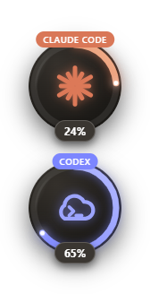
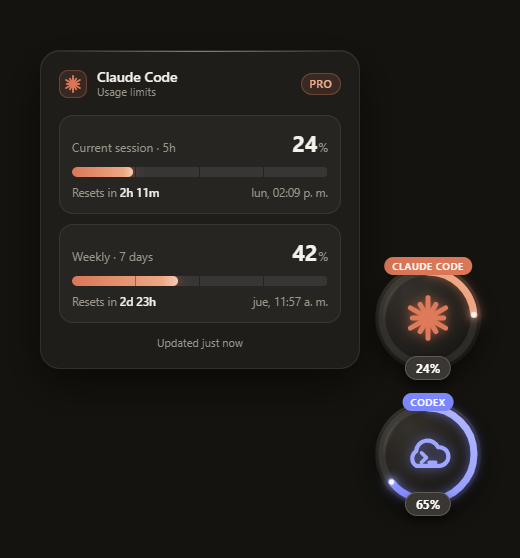

# Agent Usage Widget

A small floating desktop widget that shows the **subscription usage limits** of your AI coding agents, so you stop opening
the usage page of each tool. No API keys: it reads the data your agents already produce.

One glass bubble per detected agent (**Claude Code** and **Codex** today). The ring around each bubble fills with your
5-hour usage. Click a bubble to open a detail panel with every limit window, its percentage and the time left until it resets.

<p align="center">
  
</p>
<p align="center"><sub>Demo data (<code>npm run dev:demo</code>). Each ring fills with the 5-hour usage of its agent.</sub></p>

<p align="center">
  
</p>
<p align="center"><sub>Demo data. Clicking a bubble opens the detail panel to its left, with one card per limit window.</sub></p>

## Features

- **Dynamic detection.** One agent found, one bubble. Two found, two bubbles. An agent appears or disappears while the app is running and the widget follows.
- **Live ring.** It follows the shortest window (5h), turns amber from 70% and red with a pulse from 90%.
- **Detail panel.** Fixed size, one card per window (for example *Current session · 5h* and *Weekly · 7 days*) with a progress bar, reset countdown and last update.
- **Automatic reset.** When a window passes its reset time the widget zeroes it by itself and waits for the next prompt.
- **Move and resize like an image.** Drag to move. Double-click to enter edit mode, drag the corner handles to resize, confirm with the check button (or `Enter`) or cancel with the X (or `Esc`). Position and size are remembered.
- **Safe Claude Code connection.** A one-time prompt, a backup of your settings, wrapping of any statusLine you already have, and a one-click disconnect.
- **Respects reduced motion** and has keyboard-friendly buttons with labels.

## Requirements

| Requirement | Notes |
| --- | --- |
| Windows 11 | The only platform tested. |
| Node.js 20 or newer, npm 10 or newer | Tested with Node 20.20 and npm 10.8. |
| Git | Also used by Claude Code on Windows (Git Bash), see [Claude Code integration](#claude-code-integration). |
| Claude Pro or Max subscription | To see Claude limits. They are only exposed to subscribers. |
| Codex signed in with a ChatGPT plan | To see Codex limits. |

You only need the agents you actually use: a bubble appears for each one the widget finds.

## Quick start

```bash
git clone https://github.com/xJerson/agent-usage-widget.git
cd agent-usage-widget
npm install
npm run dev
```

The widget appears in the bottom-right corner of your primary display. Look for the tray icon to quit or manage it.

Want to see the UI without any real agent data? Run it with simulated data for both agents:

```bash
npm run dev:demo
```

### Build a production bundle

```bash
npm run build      # outputs to ./out
npm run preview    # builds and launches the production bundle
```

There is no installer yet (see [Known limits](#known-limits)).

## Using the widget

| Action | How |
| --- | --- |
| Open or close the detail panel | Click a bubble |
| Move the widget | Drag any bubble |
| Resize | Double-click a bubble (or tray menu **Edit size and position**), drag a corner, then confirm or cancel |
| Reset position | Tray menu **Reset position** (useful if you changed monitors) |
| Start with Windows | Tray menu **Start with Windows** (off by default) |
| Quit | Tray menu **Quit** |

The scale applies to the bubbles only. The detail panel always keeps its own fixed size, so it stays readable at any scale.

## Claude Code integration

Claude Code only hands its rate limits to its `statusLine` command, so the widget registers a tiny hook there.
**Nothing is changed without your consent.**

On the first launch where Claude Code is detected but not connected, the Claude bubble dims its logo and shows a check
("Connect") and an X ("Not now") on top of it, with the caption "Connect Claude?". Click the caption to open
**What changes?**, which shows your `statusLine` entry before and after. Either choice dismisses the buttons for good.
Afterwards use the tray menu: **Connect Claude Code…** or **Disconnect Claude Code**.

What Connect does, all under `~/.claude`:

1. Backs up `settings.json` to `usage-widget/backup/settings.<timestamp>.json`.
2. Copies a dependency-free hook to `usage-widget/hook.js` (a stable path, refreshed on startup while connected).
3. Sets `statusLine.command` to `node "<...>/hook.js"`. If you already have a statusLine it is **wrapped, not replaced**:
   `node "<...>/hook.js" --then "<your original command>"`. The hook saves Claude's JSON to `usage-widget/claude.json`,
   runs your original command with the same input and forwards its output and exit code, so your status bar looks the same.
4. Saves your original `statusLine` object in `usage-widget/connector.json`.

Other keys and the file formatting are preserved, writes are atomic and connecting twice never double-wraps. If
`settings.json` is not valid JSON the widget refuses and leaves it alone.

**Disconnect** restores the original `statusLine` exactly (or removes the key if there was none). Backups are kept.

**Manual alternative.** If you prefer not to let the widget edit your settings, add this single line to your own statusline
script, right after it reads stdin into `$input` (also in `scripts/claude-statusline-snippet.sh`):

```bash
mkdir -p ~/.claude/usage-widget && printf '%s' "$input" > ~/.claude/usage-widget/claude.json
```

`node` must be on the PATH of the shell Claude Code uses. On Windows the wrapped command runs through Git Bash; the hook
looks for Git for Windows' `bash.exe` explicitly and never uses the WSL launcher in `System32`.

## Where the data comes from

| Agent | Detected when | Source | Notes |
| --- | --- | --- | --- |
| Claude Code | `~/.claude` exists | `~/.claude/usage-widget/claude.json`, written by the hook | Windows of 300 and 10080 minutes from `rate_limits.five_hour` and `seven_day`. Updated after each Claude response. Without data yet, the bubble shows 0% and "Waiting for first prompt". |
| Codex | `~/.codex/sessions` exists | The most recently active `rollout-*.jsonl` files under `~/.codex/sessions` | Reads only the tail of the 8 most recently modified files from the last 7 days and takes the `rate_limits` snapshot with the newest event timestamp. Read-only; only rate-limit fields are parsed. |

The widget never writes into `~/.codex`. It writes into `~/.claude` only after you click Connect (and on Disconnect).

Codex's `/status` shows what is **left** (56% left) while the widget shows what is **used** (44%). They are the same number.

## Development

```bash
npm run typecheck   # TypeScript for main/preload/shared and for the renderer
npm test            # vitest: pure logic plus provider IO against temp dirs
npm run test:watch  # tests in watch mode
```

The project was built test-first: parsing, reset logic, thresholds, resize and clamping geometry, the connector and the
one-time prompt all have unit tests that never touch your real `~/.claude`.

### Debug environment variables

| Variable | Effect |
| --- | --- |
| `USAGE_WIDGET_DEMO=1` | Simulated data for both agents (Codex disappears for 10s every 50s to show live add/remove). Never touches `~/.claude`. |
| `USAGE_WIDGET_DEBUG=1` | Logs usage updates and renderer console output to stdout. |
| `USAGE_WIDGET_HOME=<dir>` | Looks for `.claude` and `.codex` under `<dir>` instead of the real home (safe testing). |
| `USAGE_WIDGET_USER_DATA=<dir>` | Overrides Electron's `userData` folder (layout and consent state). |
| `USAGE_WIDGET_SCREENSHOT=<file.png>` | Writes a PNG of the widget after 5s and quits. |

If your shell sets `ELECTRON_RUN_AS_NODE`, unset it first or the app will not start as a window.

### Project structure

```
src/shared     types, IPC contract and pure logic (labels, levels, reset/expiry, geometry, resize math)
src/main       Electron main process
  providers/   one UsageProvider per agent: pure parsers + thin file IO
  connectors/  Claude Code connect/disconnect and the statusLine hook
  usageService registry and reconcile loop (rescan every 5s, fs.watch with debounce)
  widgetController, floatWindows   window position, scale, drag, edit mode and the separate panel/toast/edit-bar windows
  tray.ts      tray icon (drawn in code) and menu
src/preload    strict contextBridge API (window.widget)
src/renderer   React UI (bubbles, panel, edit frame and bar, toast)
```

The design is hexagonal: `UsageProvider` (in `src/shared/types.ts`) is the port and `ClaudeProvider` and `CodexProvider` are
adapters. Parsing is pure and unit-tested; file access is a thin layer around it.

### Add another agent

1. Implement a `UsageProvider` (`id`, `name`, `detect()`, `read()`, `watchTargets()`) under `src/main/providers/`.
2. Register it in `src/main/providers/index.ts`.
3. Add its logo to `src/renderer/lib/registry.tsx` (brand colors come from the provider's `AgentInfo`).

Units: `UsageWindow.resetsAt` is epoch **seconds** (as both sources give it) and `UsageSnapshot.updatedAt` is epoch
**milliseconds**.

## Troubleshooting

| Symptom | What to check |
| --- | --- |
| The widget does not appear | Look for the tray icon. Use **Reset position** in case it ended up off-screen. Run `npm run dev` and read the terminal output. |
| It starts as a plain Node process or exits immediately | Unset `ELECTRON_RUN_AS_NODE` in your shell. |
| Claude bubble stays at 0% with "Waiting for first prompt" | Connect Claude Code from the tray menu, then send one prompt. Limits only exist for Pro/Max accounts and only after the first response of a session. |
| Claude numbers look old | They refresh after each Claude response. Between messages they can lag a few points. |
| No Codex bubble | Codex must have run at least once so that `~/.codex/sessions` exists. |
| Numbers differ from Codex `/status` | `/status` shows the percentage left, the widget the percentage used. A small lag can also appear until Codex writes its next event. |
| Your status bar looks different after connecting | Run **Disconnect Claude Code** (restores your original) and open an issue with your statusLine command. |

## Known limits

- The glass blur applies to the widget's own content only; a transparent Electron window cannot blur the desktop behind it.
- Claude does not report its plan name in the statusline JSON, so the Claude panel shows no plan badge.
- Both sources update when the agent writes data, so the widget is near real time while you work and shows the last known value while you are idle.
- Windows 11 is the only tested platform. There is no installer yet (no electron-builder); `npm run build` produces the runnable bundle.
- Not yet verified on multi-monitor setups.

## License

[MIT](LICENSE)

## Roadmap

- Installer with electron-builder.
- Gemini support, once it is confirmed that it exposes its limits.
- Per-agent windows that can be moved independently.
